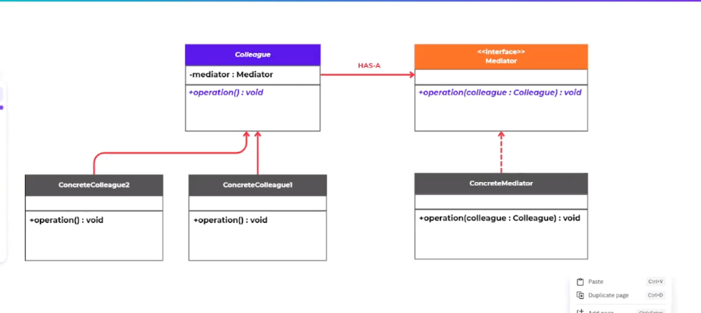
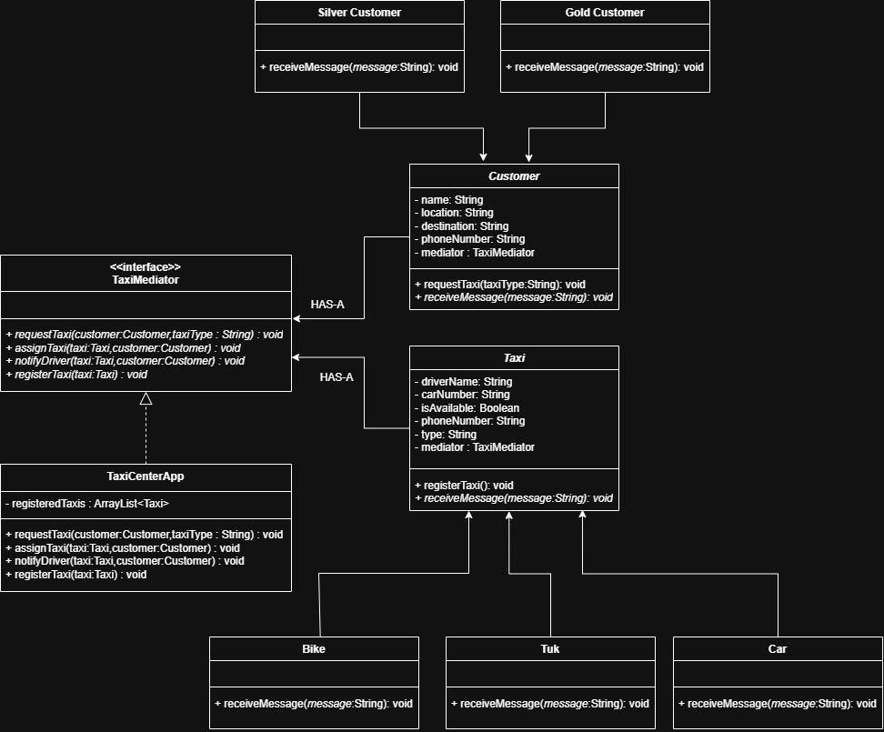
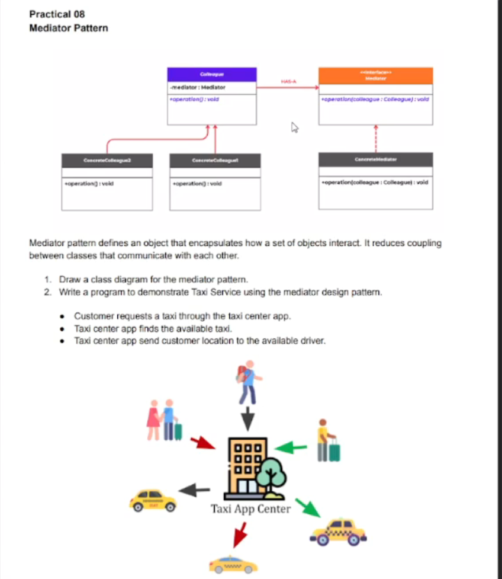

# Mediator Design Pattern

## Overview

The Mediator Design Pattern is a behavioral design pattern that reduces the direct communication between objects and replaces it with a central mediator object. Instead of many classes talking to each other directly, they communicate through one mediator.

This pattern is useful when:
- many objects are tightly coupled,
- communication logic becomes complex,
- you want to centralize object interactions,
- you want to reduce dependencies between classes.

## Theory Notes

In the Mediator pattern, there are two main concepts:

- Colleague: a class that participates in communication.
- Mediator: a central object that coordinates communication between colleagues.

The mediator controls and simplifies how colleagues interact. As a result, the system becomes easier to maintain and extend.

### Main idea

Without mediator:
- A talks to B
- A talks to C
- B talks to C
- and every class knows about the others

With mediator:
- A, B, and C do not communicate directly
- all interaction goes through a mediator
- the mediator decides what happens based on the message or event

## General Class Diagram

The general structure of the Mediator pattern is:

- Mediator (abstract/interface)
- ConcreteMediator
- Colleague (abstract/base class)
- ConcreteColleagueA / ConcreteColleagueB

### Class diagram explanation

- `Mediator` declares communication methods.
- `ConcreteMediator` manages the interaction logic.
- `Colleague` knows the mediator but not the other colleagues.
- `ConcreteColleague` objects communicate by sending requests to the mediator.

## Suitable Use Cases

The Mediator pattern is suitable when:

- a group of objects communicates in a complex way,
- there are many-to-many relationships between objects,
- one object is responsible for coordinating behavior,
- you want to reduce coupling and improve maintainability,
- you are building a chat system, workflow system, or booking system.

### Example: Taxi Booking System

This repository demonstrates a taxi booking service where:

- customers request a taxi,
- taxi center app acts as the mediator,
- taxis and customers do not directly coordinate with each other,
- the mediator finds an available taxi and assigns it.

The practical example is implemented in:
- `src/main/java/lk/kaushalya/practical/Practical.java`

## Not Suitable Use Cases

The Mediator pattern is not suitable when:

- the communication is simple and direct,
- only a few classes interact with each other,
- there is no real need for central control,
- adding a mediator would add unnecessary complexity,
- the system is very small and straightforward.

### Why not use it in a small project?

If only two or three classes communicate, creating a mediator can make the design more complicated than necessary.

## Real-World Implementations

The Mediator pattern appears in many practical systems:

- air traffic control system: planes communicate through the control tower
- chat application: chat room manages messages between users
- online taxi service: central app coordinates drivers and passengers
- event handling systems: central event dispatcher routes actions to listeners
- GUI frameworks: dialog boxes coordinate components like buttons and text fields

## Practical Example in This Project

This project uses a taxi service as the real-world implementation of the mediator pattern.

### Roles in the example

- `TaxiMediator`: mediator interface
- `TaxiCenterApp`: concrete mediator
- `Customer`: colleague
- `Taxi`: colleague
- `SilverCustomer`, `GoldCustomer`: concrete customer types
- `Bike`, `Tuk`, `Car`: concrete taxi types

### Practical diagram

### Program output screenshot

## Benefits

- reduces direct dependencies between objects
- centralizes complex communication logic
- simplifies system maintenance
- improves reusability of classes
- makes future changes easier

## Drawbacks

- the mediator can become a large, complex class
- it introduces a single point of coordination
- if the mediator has bugs, many interactions can be affected

## Summary

The Mediator Design Pattern is ideal for systems with many objects that need to cooperate but should remain loosely coupled. It is especially useful in coordinated systems such as taxi booking, chat rooms, and traffic control. However, for simple or small systems, using a mediator may add unnecessary complexity.

## Project Files

- General class diagram: `src/main/java/lk/kaushalya/model/GenaralClassDiagram.png`
- Practical diagram: `src/main/java/lk/kaushalya/practical/practical_Diagram.png`
- Practical output image: `src/main/java/lk/kaushalya/practical/practical.png`
- Java example code: `src/main/java/lk/kaushalya/practical/Practical.java`

## Notes

This repository demonstrates the Mediator pattern with a practical taxi service example and includes supporting diagrams for learning and documentation purposes.
